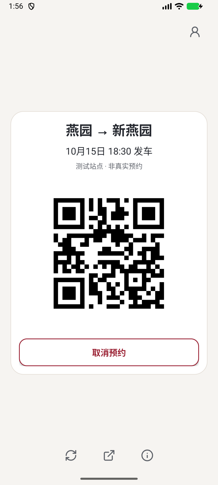
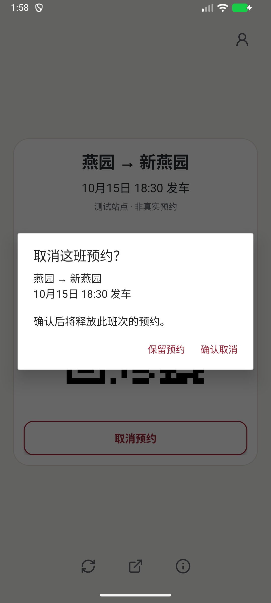

# PKUAutoBus

> 北京大学燕园 ↔ 新燕园直达班车预约 Android 客户端（非官方）。

[](https://github.com/ThunderWe1/PKUAutoBus)
[](https://github.com/ThunderWe1/PKUAutoBus)
[](LICENSE)
[](https://github.com/ThunderWe1/PKUAutoBus/releases/latest)

PKUAutoBus 是一个非官方的 Android 客户端，用于预约北京大学燕园 ↔ 新燕园直达班车。每个人在自己的手机上通过北大官方页面登录，App 只在本机保存会话和加密的预约数据；没有后端、共享账号、Google Play 服务或后台定位权限。

## 特性

- **官方页面登录**：密码只在北大官方 WebView 中输入，App 不收集；Cookie 保留在本机。
- **校区自动判定**：系统粗略定位在本机匹配海淀 / 昌平边界，位置不会上传；也可以手动切换出发校区。
- **自动选班**：预约当天最早、仍有名额且可预约的直达班次。
- **乘车二维码**：预约成功后票卡显示二维码；发车后 10 分钟过期，官网报告已使用 / 已取消 / 已失效时立即失效。
- **取消预约**：二次确认后释放班次；结果未确认时不会重复提交。
- **离线可用**：乘车码加密缓存，临时断网仍可见并提示状态，恢复后与官网核对。
- **轻量原生**：Kotlin + Android View；除官方登录外不套 WebView；无分析 SDK，轮询只在前台运行。
- **可验证**：19 个 JVM 单元测试和 9 个仪器化测试，使用隔离的假门户，不会真实预约或取消。

## 截图

<p align="center">
  
  
  
</p>

> 截图来自仪器化测试的假门户数据；二维码是明确标注的测试 payload，不能用于乘车。

## 下载

前往 [Releases](https://github.com/ThunderWe1/PKUAutoBus/releases) 下载最新的 APK（当前为 `PKUAutoBus-1.0.0.apk`）。

- 系统：Android 8.0+（API 26+），target API 36
- 体积：约 2.2 MB
- 网络：仅访问北大预约官网与登录页

> 如果你装过之前的本地构建：本次 1.0.0 改用新的签名密钥，请先卸载旧版再安装；卸载会清除登录和本地预约缓存。之后用同一密钥发布的版本可直接覆盖升级。

> APK 未上架应用商店，首次安装需允许“安装未知来源应用”。

## 使用

1. 打开 App，点击右上角账户图标或“登录”，在北大官方页面完成登录。
2. 允许“使用期间”的粗略定位：海淀区选择燕园，昌平区选择新燕园。定位不可用或不在两区时，点“选择”手动切换。
3. 确认出发校区和发车时间，点“预约”。App 会选择当天最早的可预约直达班次。
4. 预约成功后，中央票卡显示乘车二维码，乘车时向司机出示。
5. 需要取消时，点“取消预约”，核对弹窗中的班次后点“确认取消”；“保留预约”不做任何操作。

### 数据与权限

| 内容 | 说明 |
| --- | --- |
| 登录 Cookie | 只保存在本机 WebView Cookie 存储；退出登录会清除 |
| 预约与乘车码 | AES-GCM 加密，密钥由 Android Keystore 保管；排除在系统备份之外 |
| 位置 | 只在本机做区县匹配，不发送给预约官网或地图服务 |
| 网络 | 仅访问 `https://wproc.pku.edu.cn` 与登录页 `https://iaaa.pku.edu.cn` |

## 从源码构建

需要 JDK 17+、Android SDK Platform 36、Build Tools 36.0.0。项目固定 AGP 9.2.1 / Gradle 9.4.1，Gradle wrapper 已包含。

Windows：

```powershell
.\build-release.ps1
```

脚本会创建或复用 `%LOCALAPPDATA%\PKUAutoBus\signing` 下的发布密钥，运行单元测试与 release lint，并在 `dist` 生成签名 APK、源码 ZIP 和 SHA-256 校验和。请备份并保密这两个签名文件：后续更新必须使用同一把密钥，它们不会打进 APK 或源码包。

macOS / Linux 先配置 `local.properties`，然后：

```bash
./gradlew assembleRelease
```

签名可用 `PKUAUTOBUS_SIGNING_PROPERTIES` 指向包含 `storeFile`、`storePassword`、`keyAlias`、`keyPassword` 的 properties 文件。

### 测试

```powershell
.\gradlew.bat testDebugUnitTest lintDebug assembleDebug
.\gradlew.bat connectedDebugAndroidTest
```

仪器化测试使用隔离的假门户和明确标注的测试二维码，不会真实预约或取消；debug 包使用独立包名 `app.pkuautobus.debug`。

## 项目结构

```text
app/src/main/java/app/pkuautobus/
├─ MainActivity.kt      # 票卡、预约界面与二维码渲染
├─ PortalActivity.kt    # 北大官方登录 / 官网兜底 WebView
├─ BusModel.kt          # 预约、取消、轮询与待确认状态机
├─ PortalClient.kt      # 官网接口与严格响应解析
├─ PortalHttp.kt        # Cookie、请求与服务器时钟
├─ Domain.kt            # 区县判定、选班、时钟、过期与对账
└─ TicketStore.kt       # AES-GCM + Android Keystore 缓存

app/src/main/assets/
├─ districts.json       # 海淀 / 昌平边界（OSM ODbL）
├─ LICENSE-APACHE-2.0.txt
├─ LICENSE-LUCIDE.txt
└─ THIRD_PARTY_NOTICES.txt

docs/screenshots/       # README 截图
```

## 说明与免责声明

- 本项目与北京大学没有官方关联，预约和乘车须遵守学校规定。
- 登录、预约、取消依赖学校未公开的官网接口，接口或规则变化可能导致功能不可用；App 会停止并提示改用官网。
- 实际乘车、司机扫码、定位精度和取消结果需以官网或现场为准；离线缓存的二维码不保证被服务器接受。
- “发车后 10 分钟有效”是用户设定的规则，官网报告已使用 / 已取消 / 已失效时优先。
- 校区判断使用 WGS84 边界，接受 5 分钟内、精度 5 公里内的定位；靠近区界时粗略定位可能选错，可用校区切换纠正。
- 区县边界来自 OpenStreetMap（© OpenStreetMap contributors，[ODbL 1.0](https://www.openstreetmap.org/copyright)）；图标来自 [Lucide](https://lucide.dev/)，二维码编码使用 [ZXing](https://github.com/zxing/zxing)。完整第三方许可见 [THIRD_PARTY_NOTICES.md](THIRD_PARTY_NOTICES.md)。

## License

[MIT](LICENSE)
