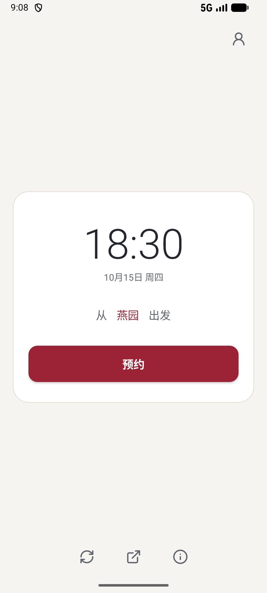

# PKUAutoBus

An unofficial Android app for the direct 燕园 ↔ 新燕园 campus buses. Each person signs in to PKU on their own phone. No backend, shared credentials, Google Play Services, or background location permission is required.

## Screenshots

<p>
  
  
</p>

These screenshots come from the instrumented tests against a fake portal. The QR is a labelled test payload and cannot be used to board.

## Use

1. Download the latest APK from the repository's [Releases](../../releases) page, or build it yourself (see [Build](#build)). Install it on Android 8.0 or later. This release uses a new signing key: uninstall any older local build first, which clears its app data. Future releases signed with this key can replace it in place. Android may ask you to allow installation from the app used to open the APK.
2. Tap **登录** or the account icon and sign in on the official PKU page. The app does not collect your password.
3. Allow approximate location while using the app. 海淀区 selects 燕园; 昌平区 selects 新燕园. Tap the campus name in **从 xxx 出发** to switch it. If location is unavailable or outside both districts, tap **选择** to choose manually. Reopening from the background restores location selection; an existing ticket stays selected.
4. Check the origin and time, then tap **预约**. It picks the earliest future, free, reservable direct departure today, without an extra walking-time buffer.
5. After confirmation, the boarding QR fills the central ticket card. It stays selected when location changes and is restored when reopening the app. It expires at departure plus ten minutes, or earlier if the portal reports it used/cancelled/invalid.
6. To cancel, tap the **取消预约** button, check the trip in the dialog, then tap **确认取消**. **保留预约** does nothing.

The app uses live portal availability without displaying remaining counts. Existing active bookings take priority over the next-bus preview. A compact selector appears if several tickets are available. Refresh, official portal, and open-source licenses are icon buttons along the bottom; long-press an icon for its label. The information icon opens the license text directly. Routine headings and status text are hidden; actionable errors and uncertain results remain visible below the central card.

An unknown result after a network timeout is kept across restarts and reauthentication. Refresh or open the official portal to reconcile it; the app never blindly repeats the booking/cancellation. Logout is unavailable while a result remains uncertain. A cached QR remains visible during a temporary outage with a stale-status notice; its acceptance still depends on the server. The phone is kept awake only while the ticket screen is visible.

## Build

Requirements: JDK 17+, Android SDK Platform 36 and Build Tools 36.0.0. The Gradle wrapper is included. Versions are pinned to the validated toolchain: AGP 9.2.1, Gradle 9.4.1.

On Windows:

```powershell
.\build-release.ps1
```

This creates or reuses the release signing key in `%LOCALAPPDATA%\PKUAutoBus\signing`, outside the repository, runs unit tests and release lint, and refreshes the signed APK, source ZIP, and both SHA-256 checksums in `dist`. Filenames use the version from the built APK. Keep both signing files private and back them up: future upgrades must use the same key. They are not included in the APK or source archive.

Android's internal `versionCode` stays at 2 so existing installations can be replaced without uninstalling or clearing data.

For an unsigned release on another machine, run `./gradlew assembleRelease` with a valid `local.properties`. Set `PKUAUTOBUS_SIGNING_PROPERTIES` to a private Java properties file containing `storeFile`, `storePassword`, `keyAlias`, and `keyPassword` to sign it.

Developer checks:

```powershell
.\gradlew.bat testDebugUnitTest lintDebug assembleDebug
.\gradlew.bat connectedDebugAndroidTest
```

The instrumented tests use an isolated fake portal and clearly labelled test QR payloads. They never reserve/cancel a real bus. Debug installs use a separate application ID (`app.pkuautobus.debug`).

## Implementation

- `Domain.kt`: offline district matching, departure selection, server-adjusted clock, ticket expiry, and pending-operation reconciliation.
- `PortalClient.kt` / `PortalHttp.kt`: observed portal requests and strict response parsing. Cookies stay in the app's WebView cookie store; requests only go to `https://wproc.pku.edu.cn`. Redirected API requests require login instead of forwarding credentials.
- `BusModel.kt`: foreground polling, durable pending writes, duplicate prevention, QR and cancellation lifecycle.
- `TicketStore.kt`: AES-GCM cache protected by Android Keystore, excluded from backup. Login/account changes clear the cache.
- `MainActivity.kt` / `PortalActivity.kt`: native ticket/booking UI and official login/portal fallback.

Current direct routes were verified on 2026-10-15: resource 7 (燕园校区→新燕园校区), resource 4 (新燕园校区→燕园校区). The app verifies these names and stops if the portal changes the mapping. Paid, group, verification, notice, or advanced-approval flows require the official portal.

QR usage is polled every two seconds and reservation status every thirty seconds while visible, with error backoff. Polling stops in the background. No booking requests are made on launch, on GPS changes, or on ticket expiry.

The ten-minute validity rule is user supplied; server-reported invalidation takes priority. Successful booking, driver scanning, physical GPS accuracy, and real cancellation require a final on-phone check. Website APIs are undocumented and may change.

## Privacy and attribution

Location is classified on-device and never sent to the reservation portal or a mapping service. Passwords are entered only into PKU's official WebView. The app has no analytics. Session cookies and encrypted ticket/pending-operation data are local; logout clears them. QR payloads and session tokens are not logged. Only share the APK, never signing files or local app data.

District polygons are bundled in `app/src/main/assets/districts.json` from OpenStreetMap relations [5505984 (海淀区)](https://www.openstreetmap.org/relation/5505984) and [2988894 (昌平区)](https://www.openstreetmap.org/relation/2988894), retrieved through Nominatim on 2026-10-15. © OpenStreetMap contributors, [ODbL 1.0](https://www.openstreetmap.org/copyright). Matching runs locally in WGS84, with no reverse-geocoding service. Location fixes up to five minutes old and with reported accuracy up to 5 km are accepted; near district borders the estimate may need correction using the campus toggle. New installs request approximate location only. Existing precise-location grants can still use GPS as a fallback.

The four utility icons use [Lucide](https://lucide.dev/) SVG geometry converted to native Android vectors, under ISC/MIT licenses. QR encoding uses [ZXing Core](https://github.com/zxing/zxing) 3.5.3 (Apache License 2.0). AndroidX and Kotlin runtime components are also Apache License 2.0. Notices and full licenses are bundled in the APK; tap the **ⓘ icon** to read them directly. See `THIRD_PARTY_NOTICES.md`.

## License

[MIT](LICENSE). Bundled third-party components keep their own licenses; see [THIRD_PARTY_NOTICES.md](THIRD_PARTY_NOTICES.md).
